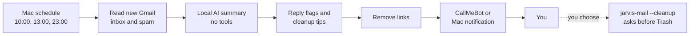

# Jarvis Marrys WhatsApp

Get a summary of your Gmail, including spam, three times a day. Jarvis tells you which emails need a reply soon and which senders are filling your inbox, and lets you clear those senders out after you confirm. Summaries are written by [OpenJarvis](https://github.com/open-jarvis/OpenJarvis) running on your own Mac and delivered to WhatsApp for free through [CallMeBot](https://www.callmebot.com/blog/free-api-whatsapp-messages/), or as a Mac notification.

```text
06 Nov 10:00: 3 new email(s), 1 in spam

REPLY SOON:
- Boss: Contract needs your signature

Boss: please review the contract today
Bank: your statement is ready
[SPAM] Prize: claims you won money, ignore

CLEANUP TIPS (on your Mac, run: jarvis-mail --cleanup):
- news@shop.example sent 9 bulk or spam emails
```

This is an independent project and isn't affiliated with OpenJarvis, CallMeBot, WhatsApp or Google.

> **Status: early.** The automated tests use simulated Gmail, Jarvis and CallMeBot services. It hasn't yet been confirmed end to end on a real Mac with real accounts.
>
> **CallMeBot is full right now.** New users who message its bot get "This Bot is full", and its [move page](https://www.callmebot.com/mov/) says the new bot number will appear "in a few days". Until then, set `DELIVERY=mac` in your settings file to get free Mac notifications instead, and switch back to `whatsapp` once you have a key.

## How it works



## What you need

- A Mac that's on at the scheduled times and set to your local time zone
- A Gmail account
- WhatsApp on your phone

## Setup

### 1. Install OpenJarvis

```bash
curl -fsSL https://open-jarvis.github.io/OpenJarvis/install.sh | bash
```

Close Terminal and open it again, then run:

```bash
jarvis doctor
```

Don't add a paid AI key such as OpenAI or Anthropic. If one is set, the OpenJarvis installer may default to that paid service.

### 2. Connect Gmail

```bash
jarvis init --preset morning-digest-mac --force
jarvis connect gdrive
```

The setup asks for a Google OAuth client, which you create in [Google Cloud Console](https://console.cloud.google.com/apis/credentials):

1. Create a project and enable the Gmail API.
2. Add yourself as a test user.
3. Create an OAuth client ID of type **Desktop app**, and paste its details into the setup.

If Google shows a redirect error, add `http://localhost:8789/callback` as a redirect URI.

### 3. Get your CallMeBot key

If CallMeBot says "This Bot is full", skip this step for now and use `DELIVERY=mac` (see the note at the top).

Save **+34 621 371 153** as a contact and send it this on WhatsApp:

```text
I allow callmebot to send me messages
```

It should reply with your API key. If nothing arrives within 2 minutes, CallMeBot says to try again after 24 hours.

### 4. Install this project

```bash
git clone https://github.com/NaomiKwamboka0/jarvis-marrys-whatsapp.git
cd jarvis-marrys-whatsapp
./install.sh
open -e ~/.openjarvis/email-whatsapp/settings.env
```

Enter your number and API key, then save the file. Use your country code and no plus sign, like `2547XXXXXXXX`.

### 5. Test it

```bash
~/.openjarvis/.venv/bin/python ~/.openjarvis/email-whatsapp/email_whatsapp.py --check
~/.openjarvis/.venv/bin/python ~/.openjarvis/email-whatsapp/email_whatsapp.py --test
```

To run a full email check straight away, use the same command with no options. Your first summary covers the last 24 hours.

## Reply flags and cleanup

**Reply soon.** The model reads each new email and names the ones that need your reply or action today. It only points at emails by number. The line you see is built from the real email, and spam can never be flagged.

**Cleanup tips.** Jarvis counts bulk mail per sender: spam plus Gmail's Promotions, Social, Updates and Forums tabs. Once a sender reaches 5 emails (change this with `CLEANUP_MIN_EMAILS`), it's suggested once. People who email you normally are never suggested.

**Clearing a sender.** WhatsApp through CallMeBot can't receive replies, so you do this in Terminal on your Mac:

```bash
jarvis-mail --cleanup                    # pick from the senders Jarvis has noticed
jarvis-mail --cleanup news@shop.example  # or name one yourself
```

It then:
1. Finds every email from exactly that address and checks each sender, so look-alike addresses aren't touched.
2. Shows the count and newest subjects, plus the unsubscribe link if the email has one. It never opens the link for you. For spam it tells you not to use it.
3. Asks you to confirm. Only typing `yes` moves anything. Pressing Enter skips, and `never` stops suggesting that sender.
4. Moves the emails to **Trash**, up to 500 per run.

**About freeing space.** Moving to Trash is deliberate, because it can be undone for 30 days. Gmail only frees the space when Trash empties itself after 30 days, or when you open Gmail, go to Trash and choose **Empty Trash now**. Permanent deletion would need broader Google access than OpenJarvis asks for, so this project doesn't do it.

## Everyday use

| To do this | Do this |
|---|---|
| See what happened | `cat ~/.openjarvis/email-whatsapp/run.log` |
| Clear out a sender | `jarvis-mail --cleanup` |
| Read the latest summary (Mac mode) | `cat ~/.openjarvis/email-whatsapp/latest-summary.txt` |
| Change the times | Edit the hours in `install.sh`, then run it again |
| Bring messages back after a pause | Send `resume` to the CallMeBot contact |
| Remove everything | `./uninstall.sh` |

If your Mac is asleep at a scheduled time, the check runs when it wakes. If it's shut down, that check is skipped and the next one catches up.

## Limits

- **CallMeBot can be unreliable.** Users [reported outages](https://community.simon42.com/t/keine-benachrichtigungen-mehr-per-whatsapp/74836) from late 2025 into January 2026. Sending `resume` helped some people, but not all.
- **Free messages may run out.** One user [reported](https://community.simon42.com/t/whatsapp-via-callmebot/70086) that free accounts hit a limit and are then asked to pay. Nothing is charged automatically, but messages could stop.
- **Long summaries use several messages.** Text is split at 900 characters.
- **Busy inboxes are capped.** Each check covers the newest 40 emails and tells you when there are more in Gmail.
- **Updating OpenJarvis can undo spam access.** Run `./install.sh` again after an update.
- **Reply flags can miss things.** A small local model decides what's urgent, so treat the list as a nudge, not a guarantee.
- **Mac notifications** may need Script Editor to be allowed in System Settings, then Notifications. The full text is always saved in `latest-summary.txt`.

## Security and privacy

Please read this before connecting a real inbox.

- **CallMeBot sees your summaries.** It's a third-party service, and summaries can include sender names and what your emails say. Don't use this with confidential work or client email.
- **OpenJarvis gets broad Google access.** Its sign-in requests `gmail.modify` and calendar edit permissions, plus read access to Drive and Contacts. This project reads mail, and only changes it when you type `yes` in the cleanup review, and then only by moving to Trash.
- **Spam can try to trick the AI.** The model gets email text with no tools, and links are removed from what's sent. A summary can still be misleading, so check anything important in Gmail.
- **Keep secrets out of Git.** Your key stays in `settings.env` on your Mac, which is private to your user account and ignored by Git. Never commit it or paste it into an issue.

## Development

```bash
python3 -m venv .venv
.venv/bin/pip install -r requirements-dev.txt
.venv/bin/pytest -q
```

| Path | Purpose |
|---|---|
| `src/email_whatsapp.py` | Reads mail, summarises it and sends messages |
| `install.sh` | Installs the script, the schedule and the `jarvis-mail` shortcut, and turns on spam access |
| `uninstall.sh` | Removes the schedule and this project's files |
| `settings.example.env` | Template for your settings |
| `tests/` | Automated tests |

## License

[MIT](LICENSE)
